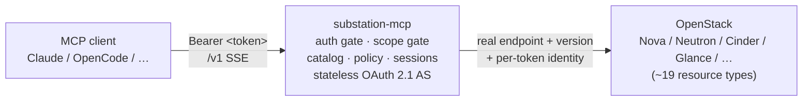

# substation-mcp

A Hummingbird-hosted Swift **MCP (Model Context Protocol) server** that lets an
LLM client consume a whole OpenStack cloud through a small, stable set of
catalog-driven tools. Every request carries its own Keystone token, so the
server is multi-tenant, holds no user credentials, and enforces project
isolation by construction.



## At a glance

- **What it is.** An MCP server for OpenStack — identity, compute, network,
  block storage, images, object storage, key management, load balancing, DNS,
  containers, orchestration, and shared file systems behind **20 tools**
  (14 read-only + 6 write).
- **Identity.** Token-per-request. No long-lived session token; the Keystone
  token *is* the identity and it's used only on that one request.
- **Auth.** Two profiles: `oauth` (default — substation-mcp fronts Keystone as
  its own stateless OAuth 2.1 AS with browser login) or `keystone_token`
  (raw bearer, unchanged). See [OAuth 2.1 login](docs/oauth.md).
- **Stable surface.** The verbs are additive-only. New services appear as new
  *resources* under the same verbs (currently 64 descriptors across ~19 types),
  never as new tools.

| | |
|---|---|
| **[Quickstart](docs/quickstart.md)** | Build → validate token → run → connect a client in ~5 steps |
| **[Tools reference](docs/tools.md)** | All 20 tools, read/write split, argument conventions |
| **[Architecture](docs/architecture.md)** | How the pieces fit: transport, client, catalog, caching |
| **[Configuration](docs/configuration.md)** | Every config key, env var, and subcommand |
| **[Security model](docs/security.md)** | Scope gating, redaction, audit, rate limits |
| **[Deploying](docs/deploying.md)** | Docker, systemd, Genestack/K8s, native aarch64 |

Full design rationale: [`specs/substation-mcp-spec.md`](specs/substation-mcp-spec.md).

## Tools

The verb tools are **stable**: `os_list`, `os_get`, `os_create`, `os_update`,
`os_delete`, `os_action`, `os_attach`, `os_detach` cover every resource. Helpers
add discovery, topology, waiting, and background tasks. Read-only mode restricts
the server to the 14 read tools; write calls need the `openstack:write` scope
else `403 insufficient_scope`. Full descriptions: [Tools reference](docs/tools.md).

| Tool | R/W | One-liner |
|------|:---:|-----------|
| `os_list` | ✓ | List a resource type with filters |
| `os_get` | ✓ | Get one resource by ID or name |
| `os_describe` | ✓ | Schema, verbs, actions, links for a resource |
| `os_topology` | ✓ | Connected-resources graph from an anchor |
| `os_find` | ✓ | Search across types by name/ID/IP |
| `os_whoami` | ✓ | Token identity: project, roles, regions |
| `os_project_readiness` | ✓ | What exists vs. what's needed to deploy servers |
| `os_quota` | ✓ | Quota usage per resource type |
| `os_clouds` | ✓ | Regions, services, endpoints |
| `os_wait` | ✓ | Poll until a target state (with progress) |
| `os_recommend_flavor` | ✓ | Flavor suggestions for a plain-English workload |
| `os_task_submit` | ✓ | Start a long-running wait in the background |
| `os_task_status` | ✓ | Poll a submitted task |
| `os_task_cancel` | ✓ | Cancel a running task |
| `os_create` | ✗ | Create a resource (schema-validated, dry-run) |
| `os_update` | ✗ | Update a resource (PATCH) |
| `os_delete` | ✗ | Delete a resource (dry-run shows blockers) |
| `os_action` | ✗ | Server action: start/stop/reboot/resize/… |
| `os_attach` | ✗ | Attach a link (volume, interface, SG, FIP, …) |
| `os_detach` | ✗ | Detach a link (FIP = disassociate, never delete) |

## Build & test

All Swift work runs inside the pinned Linux container (`swift:6.4-rhel-ubi10`)
via the `scripts/swift` wrapper — it resolves docker/podman/Apple `container`
for you. Never build natively on macOS.

```sh
scripts/swift --version   # verify the container toolchain
scripts/swift build       # debug build
scripts/swift test        # unit + in-process suite (integration self-skips w/o OSMCP_IT_CLOUD)
scripts/build.sh          # release → ./.build/release/substation-mcp
```

> The static build is attempted first but currently falls back to a
> dynamically-linked binary (Swift 6.4 on UBI10 references ICU symbols not in
> the static link path). It runs on any UBI10/RHEL 10 host with the Swift runtime.

## Next

Jump straight into the **[Quickstart](docs/quickstart.md)**, or pick a page from
the table above. Operator docs for each deploy target live alongside their
assets: [`deploy/genestack/README.md`](deploy/genestack/README.md),
`deploy/caddy/Caddyfile`, `deploy/nginx/substation-mcp.conf`,
`deploy/substation-mcp.service`.

## License

MIT - see [LICENSE](LICENSE).
