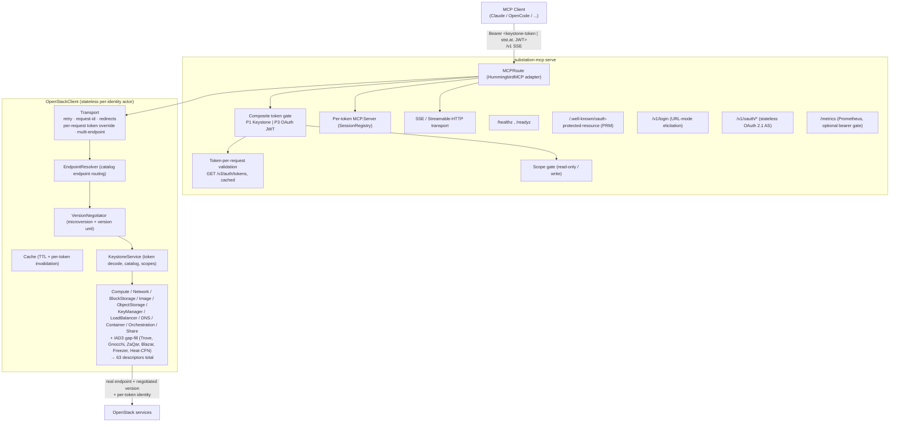

[← Documentation home](index.md)
# Architecture

## The three targets

| Target | Role | Imports |
|--------|------|---------|
| `Sources/OpenStackClient` | The OpenStack API client — transport, endpoint resolution, versioning, caching, per-service facades. **Has no MCP knowledge.** | Foundation, async-http-client, swift-log |
| `Sources/OpenStackMCPServer` | MCP server logic: catalog, tool registry, policy, sessions, resources/prompts, observability. | OpenStackClient, MCP, Hummingbird |
| `Sources/HummingbirdMCP` | Hummingbird ⇄ MCP SDK transport adapter. **OpenStack-free.** | MCP, Hummingbird, HTTPTypes, Logging |
| `Sources/substation-mcp` | Executable: thin CLI shims (`serve`, `stdio`, `check`, …). | All of the above |
| `Sources/FakeOpenStack` + `substation-mcp-fake` | In-process fake cloud (seeded) used by all tests and runnable standalone. | OpenStackClient |

The separation matters: the client can be pointed at a real cloud without an
MCP server in the loop, the adapter is reusable for any Hummingbird-hosted MCP
server, and the fake cloud drives the whole test suite in-process.

## How a request flows

1. **Auth gate.** The composite validator inspects the `Authorization` header. A
   `stst.at.` JWT (P3) is verified in-process — issuer, expiry, constant-time
   signature compare — and its embedded Keystone token id is delegated to the
   P1 `TokenValidator`. Any other bearer is treated exactly as a raw Keystone
   token (P1 path), so legacy clients are unchanged.
2. **Scope gate.** `WriteToolGate` names the tools that require write scope;
   read-only tokens get `403 insufficient_scope` on mutating calls.
3. **Catalog lookup.** The tool's `resource` enum and the target resource's
   descriptor come from the effective `ResourceCatalog` (policy-filtered).
4. **Endpoint + version.** `EndpointResolver` routes the call to the service's
   real catalog endpoint; `VersionNegotiator` picks the per-service microversion.
5. **Execute + shape.** The service facade executes, caches where appropriate,
   and shapes the result into the standard JSON envelope.
6. **Audit + metrics.** Mutating calls emit one audit record and increment
   Prometheus counters.

## Stability invariant

The verb tools are **additive-only**. Adding a new OpenStack service means adding
catalog entries (descriptors with verbs/actions/links) under the existing six
verbs — not inventing a new tool. This keeps the client surface small and stable
while the catalog grows.

See [`specs/substation-mcp-spec.md`](../specs/substation-mcp-spec.md) §5 for the
component breakdown and §10 for OpenStack API handling details.

## Related

- [Tools reference](tools.md) — the 20 tools the architecture serves.
- [Security model](security.md) — how the auth/scope gate works in detail.
- [Configuration](configuration.md) — runtime knobs that change this behavior.

